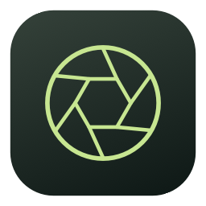

<p align="center">
  
</p>

<h1 align="center">LightImage</h1>

<p align="center">Trình chỉnh ảnh miễn phí, mã nguồn mở cho macOS, hỗ trợ preset Adobe Lightroom.</p>

<p align="center">
  <a href="https://github.com/hwo63/LightImage/releases">Tải bản cài đặt</a> ·
  <a href="#bắt-đầu-chỉnh-ảnh">Hướng dẫn sử dụng</a> ·
  <a href="#build-từ-mã-nguồn-bằng-xcode">Build bằng Xcode</a> ·
  <a href="LICENSE">Giấy phép MIT</a>
</p>

LightImage giúp bạn nhập preset Lightroom, chỉnh màu ảnh và xuất ảnh ngay trên Mac. Ứng dụng lưu các thông số chỉnh sửa theo từng ảnh và giữ nguyên tệp gốc.

## Cài đặt

Bản cài sẵn trên GitHub Releases dành cho **Mac Apple Silicon chạy macOS 14 trở lên**. Nếu kho đang ở chế độ riêng tư, hãy đăng nhập GitHub bằng tài khoản có quyền truy cập kho.

### Cài bằng DMG

1. Mở [GitHub Releases](https://github.com/hwo63/LightImage/releases), chọn phiên bản cần tải và mở phần **Assets**.
2. Tải tệp có đuôi `.dmg` rồi mở tệp đã tải.
3. Kéo **LightImage.app** vào thư mục **Applications** trong cửa sổ bộ cài.
4. Mở **LightImage** từ **Applications**. Sau đó bạn có thể đẩy ổ đĩa LightImage ra trong Finder.

### Cài bằng ZIP

1. Tải tệp có đuôi `.app.zip` trong **Assets** của bản phát hành.
2. Giải nén để lấy **LightImage.app**.
3. Chuyển ứng dụng vào **Applications** rồi mở từ đó.

Bản thử hiện được ký ad-hoc. Nếu macOS chặn bản tải về vì thiếu chữ ký Developer ID và notarization, bạn có thể [build từ mã nguồn bằng Xcode](#build-từ-mã-nguồn-bằng-xcode).

### Cập nhật trong ứng dụng

Các bản cài có bộ tự cập nhật kiểm tra GitHub Releases khi mở LightImage và định kỳ trong lúc ứng dụng chạy. Khi gói mới đã tải xong và qua kiểm tra chữ ký, **Restart to Update** xuất hiện ở góc dưới bên phải. Bấm nút để lưu thư viện, cài rồi mở lại LightImage. Bạn vẫn dùng phiên bản cũ khi chưa bấm, kể cả khi thoát ứng dụng theo cách thông thường.

Nếu đang dùng bản **26.0.1** đã phát hành, hãy cài thủ công một lần khi bản đầu tiên có bộ tự cập nhật xuất hiện. Mở ứng dụng từ Applications để LightImage có thể cập nhật tệp cài.

## Bắt đầu chỉnh ảnh

1. Bấm **Nhập ảnh** (⌘O) hoặc kéo ảnh hay thư mục vào ứng dụng. Chọn **Khám phá với ảnh minh họa** nếu muốn thử ngay.
2. Bấm **Nhập preset** (⇧⌘I), chọn tệp `.xmp`, `.lrtemplate` hoặc thư mục preset. Giải nén preset trước nếu nhận được tệp ZIP.
3. Chọn ảnh rồi bấm preset ở cột trái. Dùng **Cường độ preset** hoặc các thanh ở cột phải để tinh chỉnh. Hai tệp trong [Samples](Samples) là preset mẫu để thử nhập.
4. Dùng **Trước / Sau** hoặc **Kéo vạch** để so sánh. Cuộn chuột để zoom và kéo ảnh để kiểm tra chi tiết. Hai bản xem trước giữ cùng mức zoom và vị trí.
5. Bấm **Xuất ảnh** (⌘E), chọn định dạng, kích thước và nơi lưu. Có thể xuất một ảnh hoặc các ảnh trong bộ lọc hiện tại.

## Tính năng

| Nhóm | Công cụ |
| --- | --- |
| Thư viện | Nhập ảnh và thư mục, tìm theo tên, đánh dấu, đánh giá sao và tạo bản sao ảo. |
| Ánh sáng và màu | Phơi sáng, tương phản, vùng sáng và vùng tối, cân bằng trắng, HSL 8 nhóm màu, đường cong RGB, đen trắng, Color Grading và Calibration. |
| Chi tiết và hiệu ứng | Texture, Clarity, Dehaze, độ nét, giảm nhiễu, hạt film và tối góc. |
| Chỉnh theo vùng | Nhận diện bầu trời, chủ thể và hậu cảnh. Có cọ, gradient và cọ bám viền với xem trước nét đang kéo. |
| Chân dung | Chọn một hoặc tất cả khuôn mặt để làm sáng da, làm mịn da, thon mặt hoặc thon eo. Apple Vision phân tích ảnh trên máy. |
| Khung hình và xuất ảnh | Cắt theo tỷ lệ, xoay, lật, cân thẳng và xuất JPEG, PNG hoặc TIFF 16-bit ở sRGB. |

Trong **Chỉnh theo vùng**, dùng **Tô** hoặc **Tẩy** để sửa mép mặt nạ. Khi đang kéo cọ, bấm **Esc** để hủy nét. Giữ **Space** và kéo để di chuyển ảnh. **⌘Z** và **⇧⌘Z** hoàn tác hoặc làm lại từng nét trên mặt nạ đang chọn.

Trong **Kéo vạch**, kéo ngay trên vạch để dịch vạch. Khi đã zoom, kéo ngoài vạch để di chuyển ảnh. Bấm **Vừa khung** để trở về toàn ảnh.

## Tương thích Lightroom và RAW

LightImage đọc preset **XMP** và **LRTEMPLATE**, bao gồm nhiều thông số ánh sáng, cân bằng trắng, HSL, đường cong, grading, calibration, độ nét, giảm nhiễu và vignette. Bấm chuột phải vào một preset và chọn **Xem thông tin** để xem các thông số LightImage nhận diện và các mục còn thiếu.

LightImage mô phỏng các thông số bằng bộ xử lý riêng, nên cùng một preset có thể cho màu khác Lightroom, đặc biệt với ảnh RAW hoặc preset phụ thuộc vào profile máy ảnh. Giới hạn hiện tại gồm profile/LUT Adobe, DCP, hiệu chỉnh ống kính và quang sai tự động, mặt nạ Lightroom, healing và AI denoise. LightImage nhập từng tệp ảnh và preset. Catalog `.lrcat` và đồng bộ Adobe Cloud nằm ngoài phạm vi hỗ trợ hiện tại.

Ứng dụng mở JPEG, PNG, HEIC, TIFF và nhiều định dạng khác. Khả năng mở RAW phụ thuộc vào máy ảnh và bộ giải mã macOS. Ảnh xem trước có cạnh dài tối đa 2400 px. Khi xuất, LightImage đọc lại ảnh gốc và dùng độ phân giải đầy đủ nếu bạn chọn kích thước gốc.

## Dữ liệu và phím tắt

Thư viện tham chiếu đến vị trí ảnh gốc. Catalog và preset nằm trong `~/Library/Application Support/HWO.LightImage/`. Dùng **Help → Mở thư mục dữ liệu LightImage** để xem vị trí lưu. Nếu chuyển ảnh sang thư mục khác, dùng **Chọn lại ảnh gốc…** để nối lại đường dẫn.

| Phím tắt | Thao tác |
| --- | --- |
| ⌘O / ⇧⌘I / ⌘E | Nhập ảnh / nhập preset / xuất ảnh |
| ⌘Z / ⇧⌘Z | Hoàn tác / làm lại |
| ⇧⌘C / ⇧⌘V | Sao chép / dán chỉnh sửa |
| `\` / ⇧Y | Trước / Sau hoặc Kéo vạch |
| ⇧⌘M | Chỉnh theo vùng |
| ⇧⌘D | Tạo bản sao ảo |
| ⌘← / ⌘→ | Chuyển ảnh |

## Build từ mã nguồn bằng Xcode

**Yêu cầu**. Mac có Xcode và macOS SDK. Gói Swift khai báo macOS 14 trở lên và Swift tools 5.9. Dự án dùng SwiftUI, AppKit, Core Image và Apple Vision.

1. Tải mã nguồn từ **Code → Download ZIP** rồi giải nén, hoặc clone kho bằng Terminal.

   ```sh
   git clone https://github.com/hwo63/LightImage.git
   cd LightImage
   ```

2. Mở **Package.swift** bằng Xcode. Chờ Xcode tải xong cấu hình Swift Package.
3. Chọn scheme **LightImage** và đích chạy **My Mac**.
4. Bấm **Product → Build** (⌘B) để biên dịch hoặc **Product → Run** (⌘R) để chạy.

### Tạo app và bộ cài từ Terminal

Chạy lệnh trong thư mục có `Package.swift`. Chọn lệnh theo tệp đầu ra cần tạo.

| Lệnh | Kết quả |
| --- | --- |
| `./scripts/build-app.sh` | Tạo `dist/LightImage.app` kèm biểu tượng, preset mẫu và giấy phép. |
| `./scripts/package-release.sh` | Build ứng dụng rồi tạo thêm `.dmg` và `.app.zip` trong `dist/releases/<phiên-bản>/`. |
| `./scripts/test.sh` | Chạy kiểm thử SwiftPM, gồm nhập preset, xử lý màu, mặt nạ, chân dung và xuất ảnh. |

Các script tạo bản dựng theo kiến trúc của Mac đang build. Số phiên bản hiển thị theo mẫu `YY.major.patch (build DDMM.HHMMSS)`, với ngày giờ tính theo giờ Việt Nam.

### Phát hành bản mới trên GitHub

Workflow trên `hwo63/LightImage` chạy khi `Resources/Info.plist` thay đổi trên `main`. Tăng `CFBundleShortVersionString` theo mẫu `YY.major.patch` rồi đưa commit lên `main`. GitHub Actions kiểm thử và đóng gói `.app.zip` cùng `.dmg` cho Apple Silicon. Nó cũng tạo `Release.md` từ các commit kể từ tag phát hành trước, đính kèm file vào release và dùng chính nội dung đó làm ghi chú phát hành. Có thể chạy lại workflow **Release LightImage for macOS** từ tab **Actions**.

Thiết lập khóa ký một lần trước lần phát hành đầu tiên dùng workflow này. Chạy lệnh dưới đây tại thư mục repo. Lệnh lưu khóa riêng tư vào tệp chỉ tài khoản hiện tại đọc được và in khóa công khai.

```sh
swift scripts/sign-update.swift --create-key ~/.lightimage-update-key
```

Trong **Settings → Secrets and variables → Actions**, lưu nội dung tệp khóa riêng tư vào secret `LIGHTIMAGE_UPDATE_PRIVATE_KEY` và chuỗi công khai vào repository variable `LIGHTIMAGE_UPDATE_PUBLIC_KEY`. Nếu dùng GitHub CLI đã đăng nhập, có thể chuyển khóa riêng tư qua stdin bằng `gh secret set LIGHTIMAGE_UPDATE_PRIVATE_KEY --repo hwo63/LightImage < ~/.lightimage-update-key`.

Giữ bản sao khóa riêng tư ở nơi an toàn. Dùng cùng khóa cho các bản phát hành sau để bản đã cài tiếp tục xác thực được gói cập nhật. Khóa này ký gói cập nhật của LightImage. Chữ ký Developer ID và notarization của macOS là bước phân phối riêng.

### Cấu trúc mã nguồn

- `Sources/LightImage` chứa giao diện macOS, thư viện và luồng nhập, chỉnh, xuất ảnh.
- `Sources/LightImageCore` chứa bộ đọc preset, xử lý ảnh, mặt nạ và chân dung.
- `Sources/LightImageDiagnostics` và `scripts/compare-colors.py` hỗ trợ đối chiếu màu cục bộ. Script đo màu dùng Pillow, NumPy và scikit-image.
- `Tests/LightImageCoreTests` chứa kiểm thử. Có thể dùng `LIGHTIMAGE_PRESET_FIXTURE` và `LIGHTIMAGE_PORTRAIT_FIXTURE` để chạy với tệp thử trên máy.

## Giấy phép và đóng góp

LightImage phát hành theo [giấy phép MIT](https://github.com/hwo63/LightImage/blob/main/LICENSE) và lấy cảm hứng từ Lightroom và [Lightcraft](https://github.com/storytold/lightcraft), và ý tưởng sử dụng được preset của lightroom. Nếu gửi lỗi qua [GitHub Issues](https://github.com/hwo63/LightImage/issues), hãy ghi phiên bản LightImage, phiên bản macOS và các bước tái hiện. Nếu fork về phát triển thêm, vui lòng ghi thêm nguồn cảm hứng từ dự án LightImage này.

## Mời mình một ly cà phê ☕

Nếu LightImage hữu ích với bạn và bạn muốn ủng hộ dự án, bạn có thể quét mã QR bên dưới bằng MoMo hoặc ứng dụng ngân hàng hỗ trợ VietQR. Cảm ơn bạn đã dùng LightImage!

<a href="docs/assets/donate-coffee.png">
  
</a>
